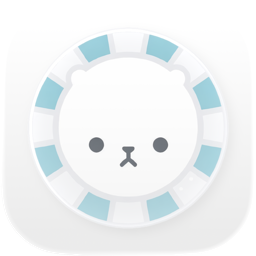

<p align="center">
  <picture>
    <source media="(prefers-color-scheme: dark)" srcset="docs/app-icon-dark.png">
    
  </picture>
</p>

<h1 align="center">maimaid</h1>

<p align="center">
  <strong>Your maimai DX pocket scorebook.</strong><br>
  Catalog, scores, Rating, chart previews, and camera capture — all in one place.
</p>

<p align="center">
  <b>English</b> · <a href="README.md">简体中文</a>
</p>

<p align="center">
  <a href="LICENSE"></a>
  <a href="https://github.com/rhythmeta/maimaid/actions/workflows/build-ipa.yml"></a>
  <a href="https://github.com/rhythmeta/maimaid/actions/workflows/build-apk.yml"></a>
  <a href="https://github.com/rhythmeta/maimaid/releases"></a>
</p>

<p align="center">
  
  
  
  
  
  
</p>

---

maimaid is a local-first companion app for **maimai DX** players, available on iOS and Android.

It is more than a score viewer: manage multiple server profiles, browse the full song catalog, capture scores with your camera, analyze Best 50 and Rating recommendations, track Plate and Dan progress, and even preview charts right on your phone. Personal data stays on your device by default, and cloud backup is entirely optional.

## 🌟 Why maimaid

- 🔒 **Local-first**: profiles, scores, play history, collections, and settings live on your device. The core app works without signing in.
- 📷 **Capture, don't type**: recognize result and song-select screens, then match the song, difficulty, and score automatically.
- 📊 **Analysis you can act on**: B35/B15 composition, theoretical B50, Rating recommendations, constant tables, and Plate progress.
- 🎮 **Arcade-style chart preview**: play the original track with a full stage renderer, notes, effects, and sound effects.
- 🌏 **Multi-server, multi-profile, multilingual**: separate Japan, International, and China profiles; the UI speaks Simplified Chinese, Traditional Chinese, English, and Japanese.
- ☁️ **Optional cloud backup**: restore all personal data from a manual snapshot when switching devices or reinstalling.

## ✨ Feature highlights

### 📊 Best 50 and Rating

- A full **B35 + B15** Best 50 table, with adjustable old/new capacity.
- A summary card showing new/old Rating share, average achievement, DX-score achievement, DX stars, average chart Rating, and B50/B15/B35 totals.
- Temporary version override, version constants or fitted constants, and **Theoretical B50** — the maximum 35 + 15 Rating available in a selected version.
- Quick filters by difficulty, category, rank, and FC/FS; filters affect the summary, list, and exported image together.
- Export your Best 50 as an image to share or keep.

### 🎵 Catalog and song details

- Browse the complete catalog, including utage charts, with covers, artists, BPM, version, category, release date, and chart counts.
- Search by title, artist, or community alias; filter by difficulty, level, version, and category; switch between list and zoomable grid views.
- Song details include chart constants and constant history, chart statistics (fitted difficulty, average achievement, sample count), your current score, and play history.
- View community aliases, jump to YouTube or bilibili searches, and download or share jacket artwork.
- Favorite songs and filter the catalog to show only favorites.

### 🎮 Chart preview

- Render the full maimai stage on your phone: notes, judgment line, hit effects, jacket-disc background, and answer/judge sound effects.
- Play the original track with a rhythm timeline, BPM-change flashes, KPS, keep-awake, and scrubbing.
- Tune note speed, mirror mode, judgment-line style, effects, and volume.
- Chart assets download on demand and are cached locally. Export a chart pack containing `maidata.txt`, the audio track, and the cover.

### 📝 Score entry and analysis

- Enter scores manually with achievement, DX score, FC/FS, and automatic rank calculation, plus input validation.
- Scan a photo from the camera or library: recognize result or song-select screens, match the song and chart, then confirm and save.
- Scanner models run on-device. They download on first use and keep working offline afterward.
- Score Query combines difficulty, rank, and FC/FS filters with sorting by Rating, achievement, or level, plus totals for scores, FC/AP, and FS/FDX.
- Each song includes a Rating table, fault-tolerance calculator, and full play history; deleting a record recalculates your best score.
- Upload new scores to linked Diving Fish / LXNS accounts — China-server profiles only, and only when enabled in Settings.

### 🧰 Everyday tools

- **Random Song**: a slot-machine draw of three or four songs.
- **Rating recommendations**: use B35/B15 replacement thresholds to see which charts are worth playing and which target rank would raise your Rating.
- **Constant Table**: generate a level-by-level constant table, optionally overlay scores, keep regular charts only, and export an image.
- **Plate Progress**: track completion and remaining charts by version, difficulty, and plate type (Kiwami / Sho / Shin / Maimai).
- **Dan Certification**: see the exam charts for regular and True Dan courses in every version, along with your progress.

### 🗂 Collections and community

- Organize charts into custom collections with rename, sort, and list/grid display.
- Share collections with an `MMD2` code or link; the web page previews them without signing in, and the app imports them in one tap.
- Community alias voting: submit candidates, browse the board, support or oppose entries, review your submissions, and respect the daily quota.
- Approved aliases sync locally and power search and song details.

### 👤 Profiles and personalization

- Multiple profiles for different servers, players, or secondary accounts, with one-tap switching.
- Set a name, server (Japan / International / China), plate, B35/B15 capacity, and avatar per profile.
- Choose a preset avatar, pick one from your library, or crop it in the built-in editor.
- iOS uses native SwiftUI. Android uses MIUIX with a Liquid Glass floating tab bar, dynamic color palettes, dark mode, predictive back, and a home-screen widget.
- The Android widget shows the active profile's DX Rating and Best 50 at a glance.
- The interface supports **Simplified Chinese, Traditional Chinese, English, and Japanese**, following the system language.

## 📱 Supported platforms

| Platform         | Requirement                  | Package                                       |
| ---------------- | ---------------------------- | --------------------------------------------- |
| 🍎 iPhone / iPad | iOS 26.0 or later            | Unsigned IPA (self-sign) or build from source |
| 🤖 Android       | Android 10 (API 29) or later | CI-built APK (primarily arm64-v8a)            |

> The first launch downloads the full catalog, covers, and preset avatars — currently about **200 MB**, and it grows with the catalog. After that, the catalog and your scores work offline. Scanner models, chart audio, and other assets download on demand.
>
> See [CHANGELOG.md](CHANGELOG.md) for release notes.

## 📥 Download and install

### Android

1. Open the latest successful [Build maimaid APK](https://github.com/rhythmeta/maimaid/actions/workflows/build-apk.yml) run.
2. Download `maimaid-apk-arm64-v8a-...` from the **Artifacts** section and install the APK. CI also publishes `armeabi-v7a`, `x86_64`, and `x86` builds for 32-bit ARM devices and emulators.
3. After installation, use **Settings → About → Check for updates** to get the latest `main` CI build. The app verifies file integrity, package name, version, and signing certificate before handing it to the system installer.

### iOS

1. Open the latest successful [Build maimaid IPA](https://github.com/rhythmeta/maimaid/actions/workflows/build-ipa.yml) run.
2. Download `maimaid-ipa-...` from **Artifacts** and unzip the unsigned IPA.
3. Self-sign it with your own Apple ID using a tool such as AltStore or Sideloadly, or build from source with Xcode.

> The app requires iOS 26.0+. CI artifacts are unsigned and cannot be installed by double-clicking; refer to your signing tool's documentation for setup.

## 🚀 First run

1. **Download the catalog**: the onboarding screen fetches the catalog, covers, and preset avatars. Wi-Fi is recommended.
2. **Create a profile**: enter your player name, choose a server and plate, and adjust B35/B15 capacity and avatar if you like.
3. **Add scores**: import from Diving Fish / LXNS, scan a screenshot, or enter scores manually.
4. **Open Best 50**: see your Rating composition, recommendations, and summary stats.

## 🔄 Imports, sync, and backups

| Source                     | Profiles     | Notes                                                                                                                                              |
| -------------------------- | ------------ | -------------------------------------------------------------------------------------------------------------------------------------------------- |
| **Diving Fish**            | All servers  | Import scores after OAuth authorization. Better local scores are preserved, and conflicts can be merged, kept local, or replaced by imported data. |
| **LXNS**                   | All servers  | Import scores after OAuth authorization. The refresh token is stored in secure device storage.                                                     |
| **Otogame**                | Japan        | Import the first four pages of play history. DX Pass data updates best scores when available.                                                      |
| **SGWCMAID**               | China        | Enter or scan a cabinet login code to fetch scores. Data comes through Rival, so FC/FS status is unavailable.                                      |
| **Rhythmeta cloud backup** | All profiles | Create manual protobuf + gzip snapshots. Restoring replaces local personal data and saves a rollback copy first.                                   |

> ⚠️ Using SGWCMAID adds one login record to your account without writing any play records. That is unusual on an official cabinet, though common among third-party score tools. Use it at your own discretion.

## 🔐 Privacy and backups

- **Local-first**: the catalog, scores, Best 50, scanner, and analysis tools work without an account.
- **Network access only when needed**: catalog / model / chart-asset updates, community-alias and account-session sync, imports or uploads you start, and optional cloud backups.
- **Scanning stays on-device**: recognition uses local models and does not upload your screenshots.
- **Credentials are separate**: Diving Fish / LXNS tokens live in secure system storage (Keychain on iOS, Keystore-encrypted storage on Android) and never enter cloud backups.
- **Cloud backup is optional**: snapshots contain profiles, scores and play history, collections, and settings, but exclude credentials and catalog assets. Each game keeps the latest three snapshots.
- **Treat links carefully**: anyone with a snapshot download link can read it, so do not share links publicly.
- **Restores are reversible**: replacement restores save a local rollback copy first, and an interrupted restore is recovered on the next launch.

## ❓ FAQ

<details>
<summary><b>Why does the first launch download about 200 MB?</b></summary>

The catalog, covers, preset avatars, community aliases, Dan data, and Plate data are published as static assets. Keeping the full catalog on-device enables offline search, artwork, and Rating calculations. Later updates only download what changed.

</details>

<details>
<summary><b>Why do scanner models need a separate download?</b></summary>

The vision models are fairly large, so downloading them on demand keeps the installation package smaller. Once downloaded, they run locally and continue working offline.

</details>

<details>
<summary><b>Why do SGWCMAID scores have no FC/FS status?</b></summary>

SGWCMAID reads scores through the Rival API, which provides achievement and DX score but not FC/FS judgments. Use Diving Fish / LXNS imports or manual entry if you need complete judgment data.

</details>

<details>
<summary><b>Will an import overwrite my existing scores?</b></summary>

Better local scores are preserved by default. When local-only or conflicting scores are found, the app lets you merge, keep local scores, or use imported scores. A cloud backup restore is a full replacement, but it saves a rollback copy first.

</details>

<details>
<summary><b>Do old accounts and cloud sync still work?</b></summary>

Accounts moved to Rhythmeta. Existing accounts remain valid, but you need to sign in again. Per-record cloud sync, cloud imports, public collection storage, and multiplayer have been retired; local imports, score uploads, and `MMD2` collection sharing still work.

</details>

<details>
<summary><b>Is my data uploaded to a server?</b></summary>

Core data stays local. The app contacts its servers to update the catalog, models, chart assets, and community aliases, to check the account session, and for imports or uploads you start or optional cloud backups. Scanning and Rating calculations happen on-device.

</details>

## 🌐 Languages

The interface supports **Simplified Chinese, Traditional Chinese, English, and Japanese**, following the system language.

## 🛠 Tech stack and development

<details>
<summary><b>Expand for the tech stack and local builds</b></summary>

- **iOS**: Swift 6.2, SwiftUI, SwiftData, Vision + Core ML, AVFoundation; iOS 26.0+.
- **Android**: Kotlin, Jetpack Compose, MIUIX, Room, DataStore, ONNX Runtime, CameraX, WorkManager; minSdk 29.
- **Static data**: TypeScript / Node.js, published through Cloudflare Workers + R2 for the catalog, covers, chart assets, and scanner models.
- **Scanning**: iOS uses Vision + three Core ML models; Android uses ONNX Runtime + PaddleOCR PP-OCRv6 + three vision models.
- **Chart preview**: Swift / Compose renderer ported from `@lxns-network/maimai-chart-engine`.
- **Repository layout**: `ios/`, `android/`, and `shared/` (cross-platform protocols), plus `static-builder/` and `static-worker/` for catalog builds and publishing. Accounts and cloud services live in [rhythmeta-backend](https://github.com/rhythmeta/gekichumai-backend) and [rhythmeta-dashboard](https://github.com/rhythmeta/gekichumai-dashboard).
- **Service endpoints**: clients default to `https://api.rhythmeta.org`; the account website is [dash.rhythmeta.org](https://dash.rhythmeta.org).

Local builds:

```sh
# Static data
pnpm install --frozen-lockfile
pnpm build:static

# Android (requires Android Studio / Android SDK)
cd android
./gradlew :app:assembleDebug

# iOS: open ios/maimaid.xcodeproj in Xcode and run the maimaid scheme
```

See [CLAUDE.md](CLAUDE.md) and [AGENTS.md](AGENTS.md) for architecture, code conventions, and detailed build notes. Issues and pull requests are welcome.

</details>

## 🙏 Credits

- [Diving Fish](https://www.diving-fish.com/) for score and community data.
- [LXNS](https://maimai.lxns.net/) for catalog, alias, icon, and score services.
- [arcade-songs](https://arcade-songs.zetaraku.dev/) for song metadata.
- [ADX / adx-dl](https://github.com/AdingApkgg/adx-dl) for the chart-asset catalog (metadata under CC BY 4.0).
- [gekichumai/dxrating](https://github.com/gekichumai/dxrating) for song and constant metadata.
- Thanks to charaDiana, Keritial, and every player and contributor who provided annotations, testing, feedback, or funding.

## 📄 License

This project is released under the **GNU General Public License v3.0**. See [LICENSE](LICENSE).

maimai and its game assets and trademarks belong to SEGA and their respective owners. maimaid is an independent community project and is not affiliated with SEGA. Jackets, charts, audio, and other game assets are not covered by the GPL. When using import, upload, or cabinet-related features, follow the terms of service of the relevant platforms.

## 💖 Support development

If maimaid is useful to you, donations of any amount are welcome. Your support is the biggest reason development and maintenance continue.

ERC20: `0x1360a13425f5982dfe09a9f3b7046db80080c88d`

Or scan the QR code:


