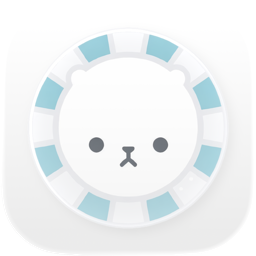

<p align="center">
  <picture>
    <source media="(prefers-color-scheme: dark)" srcset="docs/app-icon-dark.png">
    
  </picture>
</p>

<h1 align="center">maimaid</h1>

<p align="center">
  <strong>你的 maimai DX 随身成绩本。</strong><br>
  曲库、成绩、Rating、谱面预览与拍照录入，全部装进口袋。
</p>

<p align="center">
  <a href="README-en-US.md">English</a> · <b>简体中文</b>
</p>

<p align="center">
  <a href="LICENSE"></a>
  <a href="https://github.com/rhythmeta/maimaid/actions/workflows/build-ipa.yml"></a>
  <a href="https://github.com/rhythmeta/maimaid/actions/workflows/build-apk.yml"></a>
  <a href="https://github.com/rhythmeta/maimaid/releases"></a>
</p>

<p align="center">
  
  
  
  
  
  
</p>

---

maimaid 是一款面向 **maimai DX** 玩家的本地优先工具，提供 iOS 与 Android 客户端。

它不只是一个查分器：你可以在里面管理多个服务器档案、浏览完整曲库、拍照录入成绩、分析 B50 与吃分推荐、查看牌子和段位进度，甚至直接在手机上预览谱面。个人数据默认保存在设备本地，云备份完全可选。

## 🌟 为什么是 maimaid

- 🔒 **本地优先**：档案、成绩、游玩记录、收藏和设置都保存在设备上，不登录也能完整使用核心功能。
- 📷 **拍照即录**：识别成绩结算或选曲画面，自动匹配歌曲、难度和成绩，比手敲快得多。
- 📊 **看得懂的分析**：B35/B15 构成、理论 B50、吃分推荐、定数表和牌子进度，冲分时不再靠猜。
- 🎮 **街机级谱面预览**：在手机上播放原曲、渲染完整舞台和音效，随时研究谱面。
- 🌏 **多服务器、多档案、多语言**：日服、国际服、国服档案互不干扰；界面支持简中、繁中、English 和日本語。
- ☁️ **可选云备份**：需要换机或重装时，用一份手动快照恢复全部个人数据。

## ✨ 功能亮点

### 📊 Best 50 与 Rating

- 同时支持 **B35 + B15** 的 Best 50 表格，也可以自定义新旧曲容量。
- 汇总卡展示新旧曲 Rating 占比、平均达成率、DX 分数达成率、DX 星、平均单曲 Rating，以及 B50/B15/B35 统计。
- 支持临时版本覆盖、版本定数 / 拟合定数切换和**理论 B50**，按当前版本可用谱面推算理论最高 Rating。
- 可按难度、分类、评级、FC/FS 等条件快速筛选；筛选结果会同步影响汇总、列表和导出图片。
- 一键把 Best 50 导出成图片，分享给朋友或留作记录。

### 🎵 曲库与歌曲详情

- 完整曲库（含宴谱）浏览，显示封面、艺术家、BPM、版本、分类、发布日期和谱面数量。
- 支持按曲名、艺术家和社区别名搜索，按难度、等级、版本、分类筛选；列表与可缩放网格随意切换。
- 歌曲详情包含各难度定数、定数变化历史、谱面统计（拟合定数、平均达成率、样本数）、当前成绩和游玩记录。
- 查看社区别名、跳转 YouTube / bilibili 搜索、下载或分享曲绘。
- 收藏喜欢的歌曲，并在曲库中只看收藏。

### 🎮 谱面预览

- 在手机上渲染完整的 maimai 舞台：音符、判定线、打击特效、封面盘背景，以及 answer / judge 音效。
- 支持原曲播放、节奏时间线、BPM 变化闪烁、KPS、屏幕常亮和播放进度拖动。
- 可调整流速、镜像、判定线样式、特效开关和音量等细节。
- 谱面音频与资源按需下载并缓存；预览完成后可导出包含 `maidata.txt`、音轨和封面的谱面包。

### 📝 成绩录入与分析

- 手动录入成绩：达成率、DX 分数、FC / FS、评级自动计算，并有输入校验。
- 拍照扫描：从相机或相册识别成绩结算画面 / 选曲画面，自动匹配歌曲与谱面，确认后直接保存。
- 扫描模型在设备本地运行，首次使用时按需下载，之后可离线识别。
- 成绩查询支持难度、评级、FC / FS 组合筛选，按 Rating、达成率或等级排序，并显示游玩总数、FC/AP、FS/FDX 等汇总。
- 单曲提供 Rating 表、容错计算器和完整游玩记录；删除记录后会自动重算最佳成绩。
- 新成绩可同步到已绑定的 Diving Fish / LXNS（仅国服档案，需在设置中开启）。

### 🧰 实用工具

- **随机歌曲**：老虎机式抽取 3 首或 4 首，选择困难症的救星。
- **吃分推荐**：结合 B35/B15 替换阈值，告诉你哪些谱面值得打、打到什么评级能提升多少 Rating。
- **定数表**：按等级生成定数表，可叠加成绩标记、只保留常规谱面，并导出图片。
- **牌子进度**：按版本、难度和牌子类型（极 / 将 / 神 / 舞舞）统计完成度与剩余谱面。
- **段位认定**：查看各版本普通段位 / 真段位的考核曲目，以及自己的完成情况。

### 🗂 收藏与社区

- 把谱面整理进自定义收藏夹，支持重命名、排序、列表 / 网格展示。
- 通过 `MMD2` 分享码或链接分享收藏夹；网页可免登录预览，App 内一键导入。
- 社区别名投票板：提交新别名、查看候选、支持 / 反对投票、管理自己的提交和每日配额。
- 审核通过的别名会同步到本地，搜索和歌曲详情都会使用最新别名。

### 👤 档案与个性化

- 多档案管理：为不同服务器、不同玩家或不同小号分别建立档案，一键切换。
- 每个档案可设置名称、服务器（日服 / 国际服 / 国服）、牌子、B35/B15 容量和头像。
- 支持预设头像、相册头像和裁剪编辑器。
- iOS 使用原生 SwiftUI；Android 使用 MIUIX + Liquid Glass 浮动底栏，并支持动态取色、深色模式、预测性返回和桌面小组件。
- 桌面小组件可直接显示当前档案的 DX Rating 与 B50（Android）。
- 界面支持 **简体中文、繁體中文、English、日本語**，跟随系统语言。

## 📱 支持平台

| 平台             | 系统要求                   | 安装包                            |
| ---------------- | -------------------------- | --------------------------------- |
| 🍎 iPhone / iPad | iOS 26.0 或更高            | 未签名 IPA（需自签）或从源码构建  |
| 🤖 Android       | Android 10（API 29）或更高 | CI 构建的 APK（主要为 arm64-v8a） |

> 首次启动需要下载完整曲库、封面和预设头像，当前约 **200 MB**（会随曲库增长）。之后可以离线浏览曲库和成绩。扫描模型、谱面音频等资源会在首次使用时按需下载。
>
> 各版本变化见 [CHANGELOG.md](CHANGELOG.md)。

## 📥 获取与安装

### Android

1. 打开 [Build maimaid APK](https://github.com/rhythmeta/maimaid/actions/workflows/build-apk.yml) 最近一次成功的构建。
2. 在页面底部 **Artifacts** 下载 `maimaid-apk-arm64-v8a-...`，解压后安装 APK。CI 也会同时提供 `armeabi-v7a`、`x86_64` 和 `x86` 版本，模拟器可按需选择。
3. 安装完成后，可在「设置 → 关于 → 检查更新」中获取最新的 `main` 分支 CI 构建；应用会校验文件完整性、包名、版本和签名后再交给系统安装。

### iOS

1. 打开 [Build maimaid IPA](https://github.com/rhythmeta/maimaid/actions/workflows/build-ipa.yml) 最近一次成功的构建。
2. 在 **Artifacts** 下载 `maimaid-ipa-...`，解压得到未签名 IPA。
3. 使用 AltStore、Sideloadly 等工具，以你自己的 Apple ID 自签安装。也可以使用 Xcode 从源码构建。

> 应用需要 iOS 26.0+。CI 产物未签名，不能直接双击安装；自签工具的具体用法请参考对应工具的文档。

## 🚀 第一次使用

1. **下载曲库**：首次打开会进入引导页，下载曲库、封面和预设头像。建议在 Wi-Fi 下完成。
2. **创建档案**：填写玩家名，选择服务器和牌子，按需要调整 B35/B15 容量和头像。
3. **导入或录入成绩**：从 Diving Fish / LXNS 导入，或者拍照扫描、手动录入。
4. **查看 Best 50**：回到主页打开 Best 50，查看 Rating 构成、吃分推荐和各项统计。

## 🔄 数据导入、同步与备份

| 来源                 | 适用档案   | 说明                                                                                   |
| -------------------- | ---------- | -------------------------------------------------------------------------------------- |
| **Diving Fish**      | 所有服务器 | OAuth 授权后导入成绩；更好的本地成绩会保留，冲突时可选择合并、保留本地或使用导入数据。 |
| **LXNS**             | 所有服务器 | OAuth 授权后导入成绩；刷新令牌保存在设备安全存储中。                                   |
| **Otogame**          | 日服       | 导入最近四页游玩记录；DX Pass 数据可用时会同步更新最佳成绩。                           |
| **SGWCMAID**         | 国服       | 输入或扫描机台登录码获取成绩；通过 Rival 读取，因此不包含 FC/FS 状态。                 |
| **Rhythmeta 云备份** | 所有档案   | 手动创建 protobuf + gzip 快照，恢复时替换本地个人数据，并在恢复前保存回滚副本。        |

> ⚠️ 使用 SGWCMAID 会在你的账号上增加一次登录记录（不会写入任何游玩记录），这在官方机台上并不常见，但在第三方查分工具中较为普遍。是否使用请自行判断。

## 🔐 隐私与备份

- **本地优先**：不登录账号也可以使用曲库、成绩、Best 50、扫描和所有分析工具。
- **网络请求只发生在需要时**：更新曲库 / 模型 / 谱面资源、同步社区别名与账号会话、你主动发起的导入或上传，以及可选的云备份。
- **扫描在本机完成**：图片识别使用设备端模型，不会上传成绩截图。
- **凭据单独保存**：Diving Fish / LXNS 的令牌保存在系统安全存储中（iOS Keychain、Android Keystore 加密），不会进入云备份。
- **云备份是可选的**：快照包含档案、成绩与游玩记录、收藏、设置等个人数据，不包含凭据和曲库资源；每个游戏保留最近三份。
- **分享链接要谨慎**：任何拿到云备份下载链接的人都可以读取快照内容，请不要公开分享。
- **恢复有后悔药**：替换式恢复会先保存本地回滚副本，恢复中断时下次启动会自动处理。

## ❓ 常见问题

<details>
<summary><b>为什么第一次启动要下载约 200 MB？</b></summary>

曲库、封面、预设头像、社区别名、段位和牌子数据都会打包成静态资源。把完整曲库放在本地，才能离线搜索、看图、算 B50。后续更新只下载变化的部分。

</details>

<details>
<summary><b>为什么扫描功能还要单独下载模型？</b></summary>

视觉模型体积较大，按需下载可以减小安装包。模型下载完成后会在设备本地运行，断网也能继续识别。

</details>

<details>
<summary><b>为什么 SGWCMAID 导入的成绩没有 FC / FS？</b></summary>

SGWCMAID 通过 Rival 接口读取成绩，该接口只提供达成率和 DX 分数等基础信息，不包含 FC / FS 判定。需要完整判定数据时，可以改用 Diving Fish / LXNS 导入或手动补录。

</details>

<details>
<summary><b>导入会覆盖我现有的成绩吗？</b></summary>

默认会保留更好的本地成绩。遇到本地独有或两边不一致的成绩时，应用会让你选择合并、保留本地或使用导入数据。云备份恢复则是完整替换，但会在恢复前保存回滚副本。

</details>

<details>
<summary><b>旧版账号和旧云同步还能用吗？</b></summary>

账号已迁移到 Rhythmeta，原有账号继续有效，但需要重新登录。旧的逐条云同步、云端导入、公共收藏夹和多人游戏已停用；本地导入、成绩上传和 `MMD2` 收藏夹分享仍然可用。

</details>

<details>
<summary><b>数据会上传到服务器吗？</b></summary>

核心数据保存在本地。应用会为更新曲库、模型、谱面资源和社区别名，检查账号会话，以及你主动发起的导入 / 上传或云备份访问服务器。扫描识别和 B50 计算都在设备上完成。

</details>

## 🌐 多语言

界面已支持 **简体中文、繁體中文、English、日本語**，并跟随系统语言。

## 🛠 技术栈与开发

<details>
<summary><b>展开查看技术栈和本地构建</b></summary>

- **iOS**：Swift 6.2、SwiftUI、SwiftData、Vision + Core ML、AVFoundation，目标 iOS 26.0+。
- **Android**：Kotlin、Jetpack Compose、MIUIX、Room、DataStore、ONNX Runtime、CameraX、WorkManager，minSdk 29。
- **静态数据**：TypeScript / Node.js，通过 Cloudflare Workers + R2 发布曲库、封面、谱面资源和扫描模型。
- **扫描**：iOS 使用 Vision + 3 个 Core ML 模型；Android 使用 ONNX Runtime + PaddleOCR PP-OCRv6 与 3 个视觉模型。
- **谱面预览**：基于 `@lxns-network/maimai-chart-engine` 移植的 Swift / Compose 渲染器。
- **仓库结构**：`ios/`、`android/`、`shared/`（跨端协议），以及 `static-builder/`、`static-worker/`（曲库构建与发布）。账号与云服务位于 [rhythmeta-backend](https://github.com/rhythmeta/gekichumai-backend) 和 [rhythmeta-dashboard](https://github.com/rhythmeta/gekichumai-dashboard)。
- **服务地址**：客户端默认使用 `https://api.rhythmeta.org`，账号网站为 [dash.rhythmeta.org](https://dash.rhythmeta.org)。

本地构建：

```sh
# 静态数据
pnpm install --frozen-lockfile
pnpm build:static

# Android（需要 Android Studio / Android SDK）
cd android
./gradlew :app:assembleDebug

# iOS：用 Xcode 打开 ios/maimaid.xcodeproj，选择 maimaid scheme 运行
```

更详细的架构、代码规范和构建说明见 [CLAUDE.md](CLAUDE.md) 与 [AGENTS.md](AGENTS.md)。欢迎提交 Issue 或 Pull Request。

</details>

## 🙏 致谢

- [Diving Fish](https://www.diving-fish.com/) 提供查分与社区数据。
- [LXNS](https://maimai.lxns.net/) 提供曲库、别名、图标和成绩服务。
- [arcade-songs](https://arcade-songs.zetaraku.dev/) 提供曲目数据。
- [ADX / adx-dl](https://github.com/AdingApkgg/adx-dl) 提供谱面资源目录（元数据采用 CC BY 4.0）。
- [gekichumai/dxrating](https://github.com/gekichumai/dxrating) 提供曲目与定数元数据。
- 感谢 charaDiana、Keritial 以及所有提供标注、测试、反馈和资金支持的玩家与贡献者。

## 📄 License

本项目以 **GNU General Public License v3.0** 发布，详见 [LICENSE](LICENSE)。

maimai 及其游戏素材、商标归 SEGA 及各自权利人所有。本项目是独立社区项目，与 SEGA 无官方关联；曲绘、谱面、音频等游戏素材不在 GPL 授权范围内。使用导入、上传或机台相关功能时，请遵守对应平台的服务条款。

## 💖 支持开发

如果 maimaid 对你有帮助，欢迎任意金额的捐赠。你的支持是持续开发和维护最大的动力。

ERC20：`0x1360a13425f5982dfe09a9f3b7046db80080c88d`

或直接扫描二维码：


